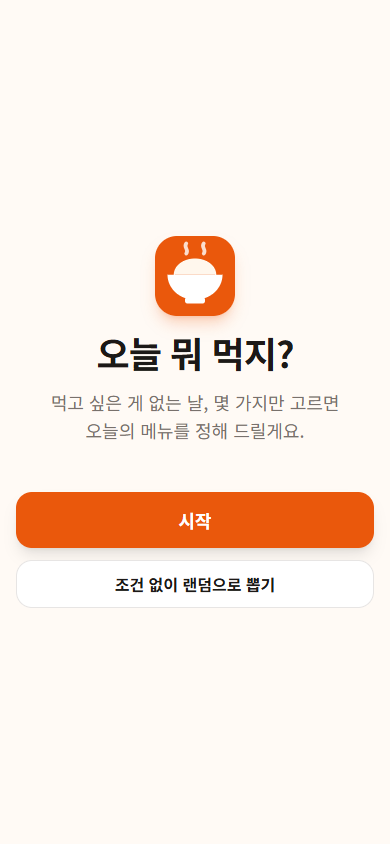
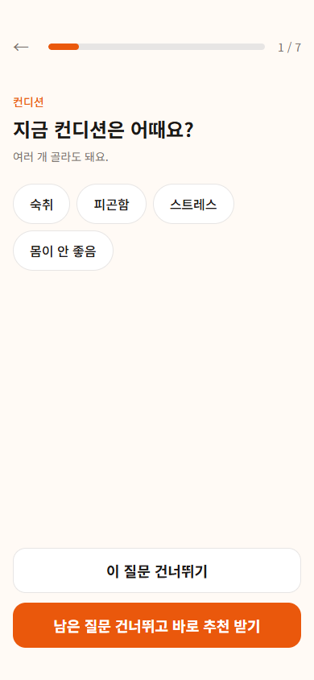
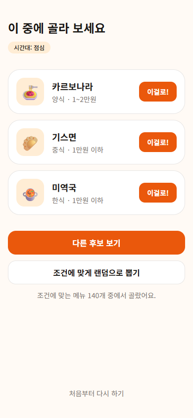
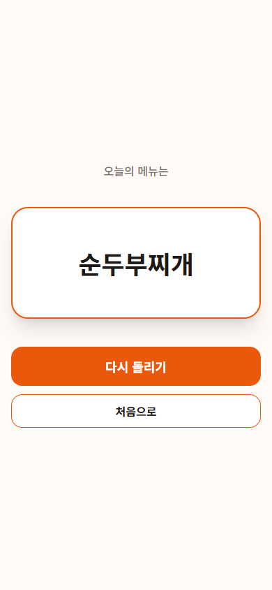

# 오늘 뭐 먹지?

뭘 먹고 싶은지 모르는 날, 컨디션·날씨·상황을 하나씩 고르면 조건에 맞는 메뉴 후보 3개를 보여 주는 웹 서비스입니다. 고르기도 귀찮으면 룰렛이 정해 줍니다.

**👉 https://today-food-recommend.vercel.app**

| 첫 화면 | 질문 | 후보 3개 | 룰렛 |
|:---:|:---:|:---:|:---:|
|  |  |  |  |

## 주요 기능

- **조건 7가지**: 컨디션(숙취·피곤함·스트레스·몸이 안 좋음), 시간대, 인원·상황, 날씨, 종류, 맛, 가격대. 모두 선택 사항입니다.
- **질문**: [시작]을 누르면 조건을 하나씩 물어봅니다. 모르면 [이 질문 건너뛰기], 귀찮으면 [남은 질문 건너뛰고 바로 추천 받기].
- **후보 3개**: 조건에 맞는 메뉴 중 랜덤 3개. [다른 후보 보기]로 다시 뽑고, [이걸로!]로 정합니다.
- **결과가 0개일 때**: "조건에 맞는 메뉴가 없어요. 조건을 하나 빼주세요." → 뺄 조건을 골라 바로 다시 추천합니다.
- **룰렛**: 메뉴 이름이 슬롯처럼 돌다가 하나에 멈춥니다. 움직임 줄이기 설정을 켠 사용자에게는 연출 없이 결과만 보여 줍니다.
  - 첫 화면 [조건 없이 랜덤으로 뽑기]: 전체 메뉴 213개에서
  - 후보 화면 [조건에 맞게 랜덤으로 뽑기]: 조건에 맞는 메뉴 전체에서

## 추천 규칙

서비스의 핵심 규칙은 [`src/lib/menu/recommend.ts`](src/lib/menu/recommend.ts) 하나에 모아 두고 테스트로 검증합니다.

```
전체 메뉴 → 고른 조건으로 거르기 → 남은 메뉴 중 랜덤 최대 3개
```

- 같은 조건 안에서 여러 개를 고르면 **하나라도 맞으면 통과 (OR)**
- 서로 다른 조건끼리는 **모두 맞아야 통과 (AND)**
- 예: 종류 = 한식·중식, 가격대 = 1만원 이하 → (한식 또는 중식) 이면서 1만원 이하
- 점수를 매기지 않고 거른 뒤 랜덤으로 뽑습니다. 남은 메뉴가 1~2개면 있는 만큼, 0개면 조건을 빼도록 안내합니다.

## 기술과 구조

Next.js 16 (App Router, Cache Components) · React 19 · Tailwind CSS 4 · Supabase (Postgres) · Vercel · Vitest · GitHub Actions

```
Supabase menus 테이블 (RLS: 누구나 읽기만)
        │  빌드 때 읽고 1시간 캐시 ('use cache' + cacheLife)
        ▼
Next.js 페이지 (정적으로 생성) ──► 브라우저에서 거르기·랜덤·룰렛
```

- 메뉴는 213개뿐이라 한 번에 내려보내고, 추천은 브라우저에서 바로 계산합니다. 조건을 바꿀 때마다 서버를 거치지 않습니다.
- 메뉴 원본은 TypeScript 파일([`menu-data.ts`](src/lib/menu/menu-data.ts))입니다. 태그에 오타가 있으면 타입 검사에서 걸리고, `npm run db:seed`로 DB에 넣습니다.
- DB도 check 제약으로 정해진 태그 값만 받습니다 ([마이그레이션](supabase/migrations/20261112000000_create_menus.sql)).

```
src/
├─ app/                 화면 (첫 화면, 질문, 후보, 룰렛)
├─ components/          칩, 로고
└─ lib/
   ├─ menu/
   │  ├─ conditions.ts  조건·선택지·질문 문구
   │  ├─ recommend.ts   추천 규칙
   │  ├─ selection.ts   고른 조건 다루기
   │  ├─ roulette.ts    룰렛 순서와 속도
   │  ├─ menu-data.ts   메뉴 213개
   │  └─ *.test.ts      테스트
   └─ supabase/         Supabase 클라이언트
```

## 테스트

로직은 모두 순수 함수로 분리해서 Vitest로 검증합니다 (49개).

- **추천 규칙**: 조건 없음, 조건 1개, OR, AND, OR+AND, 결과 1~2개, 0개, 후보 중복 없음
- **메뉴 데이터**: 200개 이상, 이름 중복 없음, 선택지마다 메뉴 5개 이상, 태그 모순 없음 (예: "몸이 안 좋음"인데 "매운 맛")
- **룰렛**: 같은 메뉴 연속 없음, 모든 메뉴가 결과가 될 수 있음, 끝으로 갈수록 느려짐

PR마다 GitHub Actions가 typecheck·lint·test를 돌리고, `main`에 머지되면 Vercel이 배포합니다. 작업은 [기획서](음식메뉴추천_상세기획.md) 8장의 티켓 단위로 PR을 나눠 진행했습니다.

## 로컬 실행

Node.js 24 이상이 필요합니다.

```bash
npm install
cp .env.example .env.local   # Supabase 값 채우기
npm run db:seed              # 메뉴 데이터 넣기 (처음 한 번)
npm run dev                  # http://localhost:3000
```

Supabase 프로젝트 만들기와 Vercel 배포는 [docs/setup.md](docs/setup.md)를 봅니다.

| 명령어 | 하는 일 |
|---|---|
| `npm run typecheck` / `npm run lint` / `npm test` | CI와 같은 검사 |
| `npm run db:seed` | 메뉴 데이터를 Supabase에 넣기 (secret key 필요) |
| `npm run menu:table` | 전체 메뉴와 태그를 표로 출력 (검수용) |

## 다음 단계

| 단계 | 내용 |
|---|---|
| v2 | 로그인과 기록 저장, 취향 학습, AI 챗봇, 주변 실제 식당 검색 |
| v3 | 모바일 앱 |

컨디션에 맞춘 추천은 의학적 조언이 아니라 메뉴 참고용입니다.
