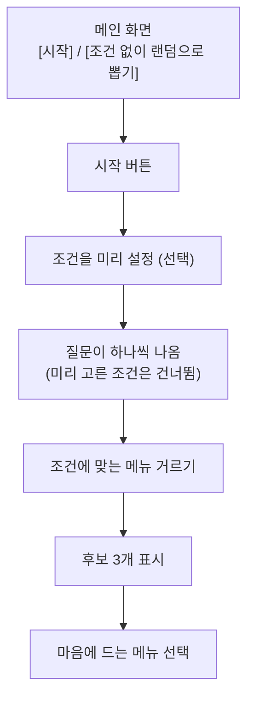
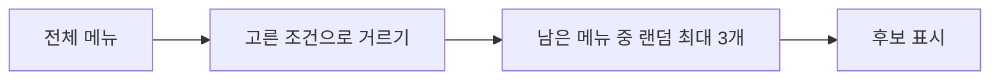
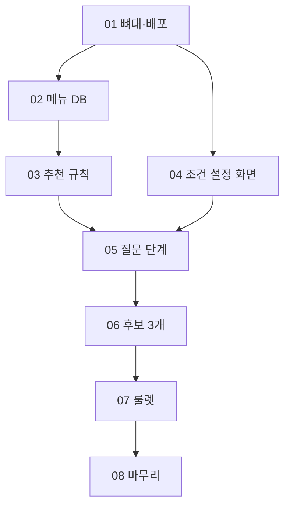

# 오늘 뭐 먹지: 음식 메뉴 추천 서비스 상세 기획서 (초안)

> **한 줄 정의**: 뭘 먹고 싶은지 모르는 날, 컨디션·날씨·상황을 하나씩 고르면 조건에 맞는 메뉴 **3개 후보**를 보여 주고 **룰렛**으로 정해 주는 웹 서비스

이 문서는 2026-11-12 대화에서 확정한 내용을 모은 초안이다. **(제안)** 표시가 붙은 항목은 초안을 채우려고 임시로 적은 것이라 아직 확정이 아니다. 확정 전에 꼭 확인한다.

| 항목 | 내용 |
|---|---|
| 프로젝트 | 개인 포트폴리오 프로젝트 |
| 형태 | 웹 (나중에 모바일로 확장 설계) |
| 기술 | Next.js + Supabase + Vercel |
| MVP 목표 시점 | 시작일(2026-11-12)로부터 2주 이내 |
| MVP 범위 | 조건 추천 + 랜덤 뽑기 (비회원으로 사용) |
| 레포 | https://github.com/kangwoohyun999/food-recommend (공개) |

---

## 목차

1. [배경과 문제](#1-배경과-문제)
2. [용어](#2-용어)
3. [사용자와 역할](#3-사용자와-역할)
4. [MVP 기능 상세](#4-mvp-기능-상세)
5. [추천 규칙 한눈에 보기](#5-추천-규칙-한눈에-보기)
6. [기술 구성](#6-기술-구성)
7. [개발 방식](#7-개발-방식)
8. [구현 티켓과 순서](#8-구현-티켓과-순서)
9. [이후 단계 (v2~v3)](#9-이후-단계-v2v3)
10. [리스크와 대응](#10-리스크와-대응)
11. [아직 정하지 않은 것](#11-아직-정하지-않은-것)

---

## 1. 배경과 문제

| 문제 | 흔한 방식에서는 | 이 서비스에서는 |
|---|---|---|
| 먹고 싶은 게 없음 | 메뉴 목록을 처음부터 훑어야 한다 | 질문을 **하나씩 따라가다 보면** 후보가 나온다 |
| 지금 상태를 반영하지 못함 | 맛·종류로만 고른다 | **숙취, 피곤함** 같은 컨디션에 맞춰 추천한다 |
| 고르는 데 시간이 오래 걸림 | 후보가 너무 많다 | 조건에 맞는 **3개만** 보여 주고 룰렛으로 정한다 |

**핵심 차별점**
1. 개인 상태(컨디션)에 맞춘 추천
2. 모르겠으면 질문을 따라가기만 하면 되는 화면

**MVP가 검증할 가설:** "먹고 싶은 게 없어도, 몇 가지만 고르면 오늘의 메뉴가 정해진다."

---

## 2. 용어

| 용어 | 뜻 | 쓰지 않는 말 |
|---|---|---|
| **메뉴** | 추천 대상이 되는 음식 하나 (예: 김치찌개) | 음식물, 요리 |
| **조건** | 추천을 거르는 기준. 컨디션, 시간대, 날씨, 인원·상황, 맛·종류, 가격대 | 필터 옵션 |
| **컨디션** | 사용자의 몸 상태나 기분 (숙취, 피곤함, 스트레스, 몸이 안 좋음) | 개인 상태 |
| **태그** | 메뉴에 붙은 꼬리표. 조건과 맞는지 비교할 때 쓴다 | |
| **후보** | 조건에 맞아 화면에 보여 주는 메뉴. 최대 3개 | 추천 목록 |
| **룰렛** | 랜덤으로 메뉴를 정하는 화면 연출 | 뽑기 |

---

## 3. 사용자와 역할

| 역할 | 단계 | 할 수 있는 일 |
|---|---|---|
| **비회원** | MVP | 조건 설정, 추천 받기, 룰렛. 기록은 저장되지 않는다 |
| **회원** | v2 | 로그인, 기록 저장, 취향 학습 |
| **운영자 (나)** | MVP | 메뉴 데이터 관리 (Supabase 대시보드에서 직접) (제안) |

- MVP에는 로그인이 없다. 가입 정보를 받지 않아서 개인정보를 모으지 않는다.

---

## 4. MVP 기능 상세

### 4.1 메인 화면과 조건 설정

- 조건은 **전부 선택 사항**이다. 고르지 않은 조건은 필터를 걸지 않는다 (예: 가격대를 안 고르면 "가격은 상관없음").
- 질문 단계에서도 같은 방식이다. 이미 고른 조건의 질문은 나오지 않는다.
- 예: [시작] 뒤 화면에서 "숙취"만 미리 골라 두면, 컨디션 질문은 건너뛰고 시간대부터 묻는다.

**조건 목록**

| 조건 | 선택지 | 상태 |
|---|---|---|
| 컨디션 | 숙취 / 피곤함 / 스트레스 / 몸이 안 좋음 | 확정 |
| 날씨 | 비 오는 날 / 추운 날 / 더운 날 (직접 선택) | 확정 |
| 시간대 | 아침 / 점심 / 저녁 / 야식 | 확정 |
| 인원·상황 | 혼밥 / 데이트 / 회식 / 친구 모임 | 확정 |
| 맛 | 매운 맛 / 담백한 맛 | 확정 |
| 종류 | 한식 / 중식 / 일식 / 양식 | 확정 |
| 가격대 | 1만원 이하 / 1~2만원 / 2만원 이상 | 확정 |

- 맛과 종류는 질문 화면에서 한 단계로 묻더라도, 거를 때는 **서로 다른 조건**으로 본다 (예: "매운 맛 + 한식"은 둘 다 맞아야 통과).

**컨디션별로 찾는 메뉴**

| 컨디션 | 필요한 메뉴 |
|---|---|
| 숙취 | 해장이 되는 메뉴 |
| 피곤함 | 든든한 메뉴 |
| 스트레스 | 자극적인 메뉴 |
| 몸이 안 좋음 | 감기·배탈 등에 순한 메뉴 |

### 4.2 후보 보기

- 조건에 맞는 메뉴 중 **랜덤으로 3개**를 후보로 보여 준다.
- 조건에 맞는 메뉴가 3개보다 적으면 **남은 개수만큼만** 보여 준다 (1~2개여도 그대로).
- 사용자는 마음에 드는 후보 하나를 고른다.

### 4.3 랜덤 뽑기 (룰렛)

- 룰렛은 **조건 없이 바로 돌리는 별도 모드**다. 메인 화면의 [조건 없이 랜덤으로 뽑기] 버튼으로 들어간다.
- 전체 메뉴에서 하나를 랜덤으로 정한다. 메뉴 이름이 슬롯처럼 빠르게 바뀌다가 점점 느려지며 멈춘다 (약 3초).
- 멈춘 뒤 [다시 돌리기], [조건 골라서 추천 받기]를 보여 준다.
- 움직임 줄이기 설정을 켠 사용자에게는 연출 없이 결과만 보여 준다.

### 4.4 메뉴 데이터

| 항목 | 내용 |
|---|---|
| 규모 | **200개 이상**으로 시작 (조건을 여러 개 걸어도 후보가 남도록) |
| 만드는 방법 | AI가 만든 목록을 DB에 넣는다. 나중에 주변 실제 식당 검색을 추가한다 |
| 검수 | AI가 만든 태그가 틀릴 수 있어서 직접 훑어 확인한다 (제안) |

**메뉴 한 개가 가지는 정보 (제안)**

| 항목 | 예시 |
|---|---|
| 이름 | 김치찌개 |
| 종류 | 한식 |
| 맛 태그 | 매운 |
| 가격대 | 1만원 이하 |
| 어울리는 시간대 | 점심, 저녁 |
| 어울리는 날씨 | 비 오는 날, 추운 날 |
| 어울리는 인원·상황 | 혼밥 |
| 어울리는 컨디션 | 숙취, 피곤함 |

---

## 5. 추천 규칙 한눈에 보기

이 서비스에서 가장 중요한 규칙이다. 규칙은 **하나의 함수**에 모아 두고 테스트로 검증한다.

| 상황 | 결과 |
|---|---|
| 조건을 하나도 안 골랐다 | 전체 메뉴에서 랜덤 3개 |
| 조건을 골랐다 | 고른 조건에 모두 맞는 메뉴만 남긴다 |
| 남은 메뉴가 3개 이상 | 그중 랜덤 3개 |
| 남은 메뉴가 1~2개 | 있는 만큼만 보여 준다 |
| 남은 메뉴가 0개 | "조건에 맞는 메뉴가 없어요. 조건을 하나 빼주세요." 문구와 [조건 하나 빼기] 버튼을 보여 준다 |

- 점수를 매기지 않는다. **거르고 나서 랜덤**으로 뽑는다.
- 같은 조건에서 여러 개를 고르면 **하나라도 맞으면 통과(OR)**, 서로 다른 조건끼리는 **모두 맞아야 통과(AND)** 한다.
  - 예: 종류에서 한식·중식을 고르고 가격대에서 1만원 이하를 고르면 → (한식 또는 중식) 이면서 1만원 이하인 메뉴.
- [조건 하나 빼기]는 고른 조건 목록을 보여 주고, 사용자가 뺄 조건을 하나 고르면 다시 거른다.

---

## 6. 기술 구성

| 영역 | 선택 | 단계 |
|---|---|---|
| 웹 앱 | Next.js | MVP |
| DB | Supabase (Postgres) | MVP |
| 배포 | Vercel | MVP |
| 메뉴 목록 만들기 | AI로 생성 후 DB에 입력 | MVP |
| 로그인·기록 | Supabase Auth (제안) | v2 |
| 챗봇 AI | Gemini API 무료 티어 | v2 |
| 주변 식당 검색 | 외부 지도·장소 API (미정) | v2 |
| 모바일 | 웹을 먼저 만들고 이후 확장 | v3 |

**챗봇 AI를 Gemini 무료 티어로 정한 이유와 주의점**
- 사용량이 적고 무료인 것을 쓰기로 했다.
- 모델별 무료 한도 숫자는 공개 문서에 없고 AI Studio 콘솔에서 확인해야 한다. 키를 발급받은 뒤 실제 한도를 보고 모델을 정한다.
- 무료 티어로 보낸 요청은 Google이 제품 개선에 쓸 수 있다. 그래서 챗봇에는 이름·위치 같은 개인정보를 보내지 않는다.

---

## 7. 개발 방식

### 7.1 테스트

| 테스트 | 무엇을 확인하나 | 방법 |
|---|---|---|
| **추천 규칙 테스트 (핵심)** | 5장의 모든 규칙 | 샘플 메뉴를 만들어 조건별 결과를 확인하는 함수 테스트 |
| 화면 E2E | MVP에서는 하지 않음 | 기능마다 직접 눌러 보며 확인 |

- 확인할 것 예: 조건 없음, 조건 1개, 조건 여러 개, 결과 2개 이하, 결과 0개.

### 7.2 DB 변경과 배포

- 메뉴 테이블 구조는 SQL 마이그레이션 파일로 레포에 둔다 (제안).
- `main`에 올리면 Vercel이 자동 배포한다.

### 7.3 환경변수

| 이름 | 공개 여부 | 쓰는 곳 |
|---|---|---|
| Supabase Project URL | 공개 | 브라우저, 서버 |
| Supabase Publishable key | 공개 | 브라우저, 서버 |
| Supabase Secret key | **비밀** | 서버 작업만. 채팅이나 코드에 절대 붙이지 않는다 |

로컬은 `.env.local`(커밋 안 됨), Vercel은 프로젝트 설정에 넣는다.

---

## 8. 구현 티켓과 순서

2주 일정에 맞춰 기능 단위로 자른다. 하나 끝날 때마다 직접 눌러 보며 확인한다. 기간은 모두 (제안)이다.

| 티켓 | 먼저 끝나야 하는 것 | 끝나면 되는 것 | 예상 기간 |
|---|---|---|---|
| 01 프로젝트 뼈대와 배포 | 없음 | Next.js 앱이 뜨고 Vercel에 배포됨 | 1일 |
| 02 메뉴 DB와 데이터 입력 | 01 | Supabase 메뉴 테이블에 AI가 만든 200개 이상 입력됨 | 2일 |
| 03 추천 규칙 함수와 테스트 | 02 | 5장의 규칙이 테스트를 통과함 | 2일 |
| 04 메인 화면과 조건 설정 | 01 | [시작]을 누르면 조건을 미리 고를 수 있음 | 2일 |
| 05 질문 단계 화면 | 03, 04 | 미리 고른 조건은 건너뛰며 질문이 하나씩 나옴 | 2일 |
| 06 후보 3개 화면 | 05 | 후보 보기, 1~2개일 때도 표시, 하나 고르기 | 1일 |
| 07 룰렛 | 06 | 룰렛으로 메뉴를 랜덤으로 정함 | 2일 |
| 08 마무리와 포트폴리오 정리 | 07 | 디자인 다듬기, README, 배포 확인 | 2일 |

**나눠 진행하기 좋은 지점:** 01이 끝나면 02와 04를 번갈아 진행할 수 있다. 일정이 모자라면 08의 디자인 다듬기를 줄인다.

---

## 9. 이후 단계 (v2~v3)

| 단계 | 범위 | 목표 |
|---|---|---|
| **MVP** | 4장 전체 | "몇 가지만 고르면 메뉴가 정해진다" 검증 |
| **v2** | 로그인, 기록 저장, 취향 학습, AI 챗봇(Gemini), 주변 실제 식당 검색 | 개인에게 맞춘 추천 |
| **v3** | 모바일 확장 | 어디서든 사용 |

### MVP에서 일부러 뺀 것

| 기능 | 언제 | 이유 |
|---|---|---|
| 로그인·기록 | v2 | 기록이 있어야 의미 있는 기능(취향 학습)과 함께 만든다 |
| 취향 학습 | v2 | 기록이 쌓여야 가능하다 |
| AI 챗봇 | v2 | 2주 안에 핵심 흐름을 먼저 완성한다 |
| 주변 식당 검색 | v2 | 외부 API 연동이 필요하다 |
| 날씨 자동 감지 | 미정 | MVP는 직접 선택. 위치 권한이 필요해 구현이 복잡하다 |

---

## 10. 리스크와 대응

| 리스크 | 대응 | 상태 |
|---|---|---|
| **AI가 만든 메뉴 데이터가 부정확** (태그가 틀림) | 직접 훑어 확인, 추천 규칙 테스트로 로직과 분리 (제안) | MVP 반영 |
| **조건을 많이 걸면 후보가 부족** | 메뉴 200개 이상으로 시작, 부족하면 있는 만큼만 표시 | MVP 반영 |
| **2주 일정이 빠듯함** | 챗봇·로그인을 v2로 미루고 기능 단위 티켓으로 진행 | MVP 반영 |
| **컨디션 추천을 의학 조언으로 오해** (몸이 안 좋음 등) | 화면에 "의학적 조언이 아니라 메뉴 참고용" 문구 표시 (제안) | MVP 반영 |
| **무료 AI 요청이 Google 제품 개선에 쓰임** | 챗봇에 개인정보를 보내지 않는다 | v2 |
| 무료 API 한도 초과 | AI Studio 콘솔에서 한도 확인, 호출 횟수 제한 (제안) | v2 |

---

## 11. 아직 정하지 않은 것

| 질문 | 왜 필요한가 |
|---|---|
| 질문 단계의 **순서** | 질문 화면 흐름이 달라진다 |
| 서비스 **이름**과 디자인 분위기 | 포트폴리오 첫인상 |
| 메뉴 데이터를 AI에게 어떻게 만들게 할까 (프롬프트, 검수 방법) | 데이터 품질 |
| 레포 이름과 공개 여부 | 포트폴리오에 링크를 걸 때 필요하다 |
